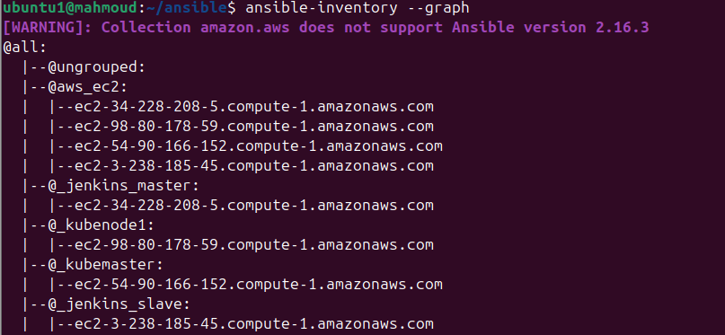
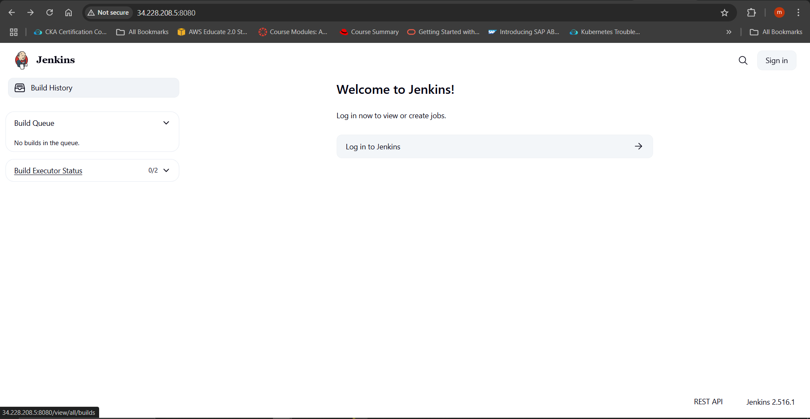
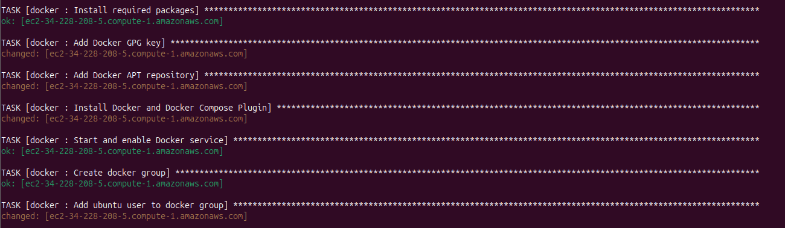
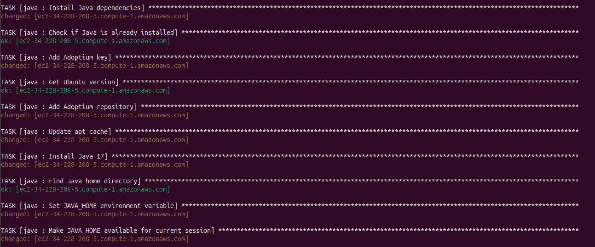
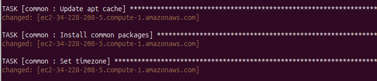
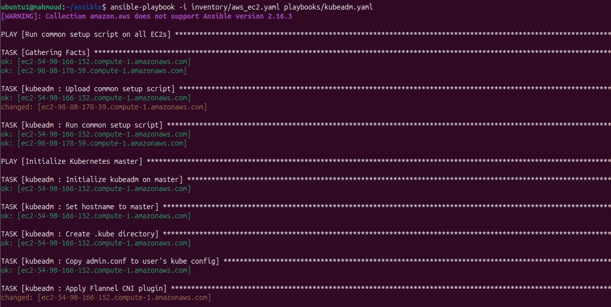
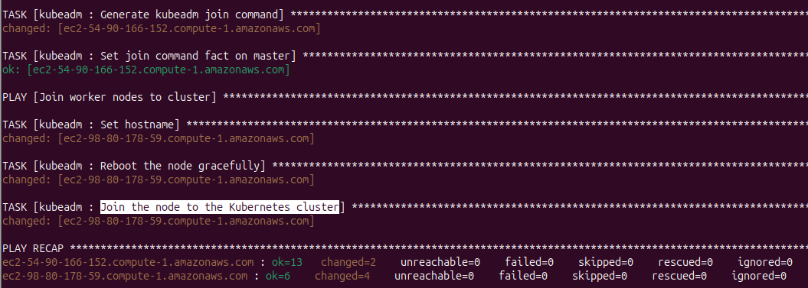
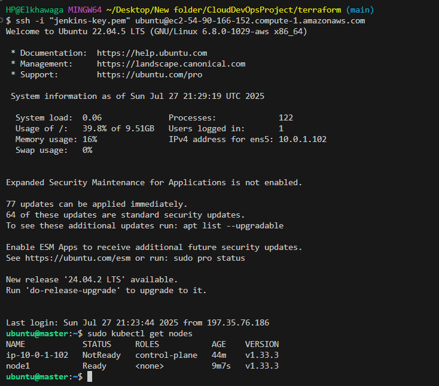

# 🔧 Ansible — configuration des machines

Configure Jenkins (master + agent), le cluster Kubernetes (kubeadm), les composants GitOps et l'agent CloudWatch.
L'inventaire est **dynamique** : il lit les instances EC2 taguées `Project=ivolve` (plugin `amazon.aws.aws_ec2`).

```text
Ansible/
├── ansible.cfg · requirements.yml · .yamllint · .ansible-lint
├── inventory/aws_ec2.yaml            # groupes _jenkins_master, _jenkins_slave, _kubemaster, _kubenode1, role_*
├── group_vars/all/
│   ├── main.yml                      # versions épinglées, variables GitOps
│   └── vault.yml.example             # secrets (à chiffrer avec ansible-vault)
├── playbooks/
│   ├── site.yml                      # tout enchaîner
│   ├── jenkins.yml                   # master → agent → enregistrement de l'agent
│   ├── kubernetes.yml                # prérequis → init master → join worker → add-ons
│   └── monitoring.yml                # agent CloudWatch
└── roles/
    ├── common  git  java  docker     # socle
    ├── jenkins_master                # Jenkins LTS + plugins + JCasC + job Job DSL + agent
    ├── jenkins_agent                 # utilisateur jenkins, clé SSH autorisée, Docker, Trivy
    ├── kubeadm                       # containerd 2, kubelet/kubeadm/kubectl gelés, init/join, Flannel
    ├── k8s_addons                    # metrics-server, ArgoCD, Application ivolve-webapp
    └── cloudwatch_agent              # métriques mémoire et disque
```

## Utilisation

```bash
pip install -r requirements-dev.txt
ansible-galaxy collection install -r requirements.yml -p collections

cp group_vars/all/vault.yml.example group_vars/all/vault.yml     # renseignez les secrets
echo 'mot-de-passe-vault' > .vault_pass && chmod 600 .vault_pass
ansible-vault encrypt group_vars/all/vault.yml --vault-password-file .vault_pass

ansible-inventory --graph
ansible-playbook playbooks/site.yml --vault-password-file .vault_pass
# ou une partie : playbooks/jenkins.yml · playbooks/kubernetes.yml · playbooks/monitoring.yml
```

## Points d'attention

- **Secrets** : plus aucun mot de passe en clair (`admin123` supprimé). Jenkins les reçoit via `/etc/jenkins/jenkins.env` (`0600`) et JCasC les référence en `${VARIABLE}`.
- **Jenkins** : le plugin manager officiel résout les dépendances ; `jenkins.yaml` (JCasC) crée l'utilisateur, les credentials `docker` / `github` / `agent-ssh`, l'agent `slave` et le job `ivolve-webapp`.
- **Agent** : le master génère une clé ed25519, l'agent l'autorise, et le master fait confiance à l'empreinte de l'hôte via `known_hosts` (pas de *Non verifying strategy*).
- **Clé du dépôt Jenkins** : `jenkins.io-2026.key` (l'ancienne clé 2023 est périmée et faisait échouer `apt update`).
- **Kubernetes** : `kubernetes_version: "1.36"` (la 1.33 de la version d'origine est en fin de vie). containerd vient du dépôt Docker car **Kubernetes 1.36 exige containerd 2.x** ; le fichier de config par défaut est régénéré (celui du paquet désactive le plugin CRI).
- **Idempotence** : chaque tâche utilise un module, `creates:` ou `changed_when:` ; relancer un playbook est sans risque.
- **Qualité** : `yamllint` propre, `ansible-lint` (profil *moderate*) sans erreur, `--syntax-check` validé.

## Accès via SSM plutôt que SSH

Le rôle IAM des instances inclut `AmazonSSMManagedInstanceCore` : vous pouvez fermer le port 22 et utiliser `aws ssm start-session --target <instance-id>`.

<details>
<summary><b>📸 Captures de la mise en œuvre d'origine</b></summary>
<br>










</details>
