# 🐙 ArgoCD — déploiement GitOps

ArgoCD surveille `k8s-manifests/` dans Git et aligne le cluster sur ce qui y est décrit.
Il est **installé et configuré par Ansible** (rôle `k8s_addons`) ; cette page explique ce qui se passe et comment intervenir.

## L'Application

[`application.yaml`](./application.yaml) est la déclaration GitOps de `ivolve-webapp` :

| Champ | Valeur | Effet |
|---|---|---|
| `source.path` | `k8s-manifests` | ArgoCD détecte `kustomization.yaml` et fait un `kustomize build` |
| `destination.namespace` | `ivolve` | Même namespace que les manifestes (l'ancienne doc disait `ivolve-app` : incohérent) |
| `syncPolicy.automated` | `prune` + `selfHeal` | Supprime ce qui n'est plus dans Git, annule les modifications manuelles |
| `syncOptions` | `CreateNamespace`, `PruneLast` | Crée le namespace, supprime en dernier |
| `retry` | 5 essais, backoff exponentiel | Tolère un registre ou un nœud indisponible |

Appliquer à la main (si besoin) :

```bash
kubectl apply -n argocd -f ArgoCD/application.yaml
```

## Accéder à l'interface

```bash
kubectl -n argocd port-forward svc/argocd-server 8081:443          # https://localhost:8081
kubectl -n argocd get secret argocd-initial-admin-secret -o jsonpath="{.data.password}" | base64 -d; echo
```

Utilisateur : `admin`. Changez le mot de passe puis supprimez le secret initial.

## Dépôt privé

Si le dépôt GitHub est privé, déclarez-le dans ArgoCD (Settings → Repositories → *Connect Repo*, HTTPS + PAT en lecture) ou via `argocd repo add`.

## Vérifier un déploiement

1. L'application `ivolve-webapp` passe de `OutOfSync` à **`Synced`**, santé **`Healthy`**
2. Ressources attendues : `Deployment` (2/2), `Service` NodePort, `HPA`, `PDB`, 2 `Pod` en `Running`
3. `curl http://<IP d'un nœud>:30080/version` renvoie le tag déployé

<details>
<summary><b>📸 Captures de la mise en œuvre d'origine</b></summary>
<br>

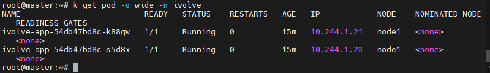
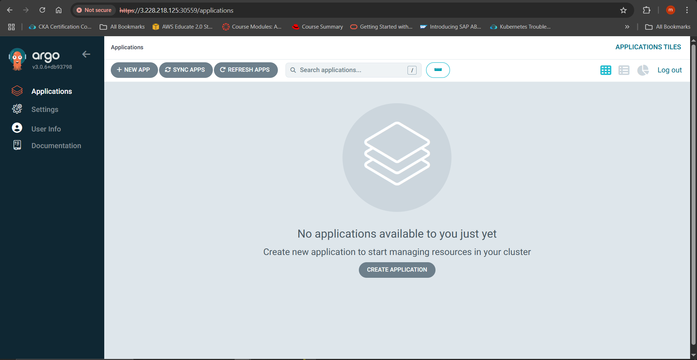
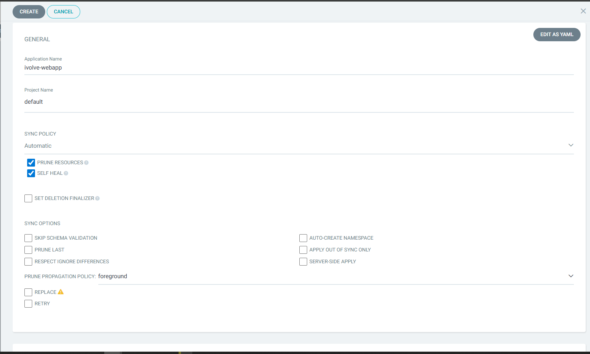
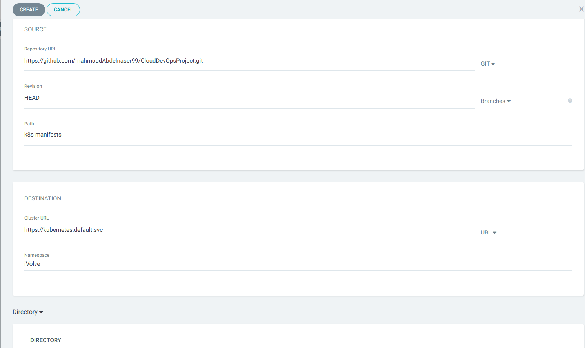
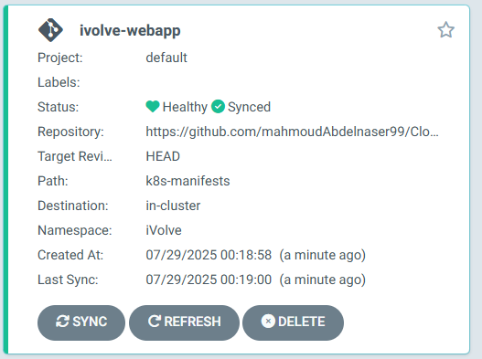
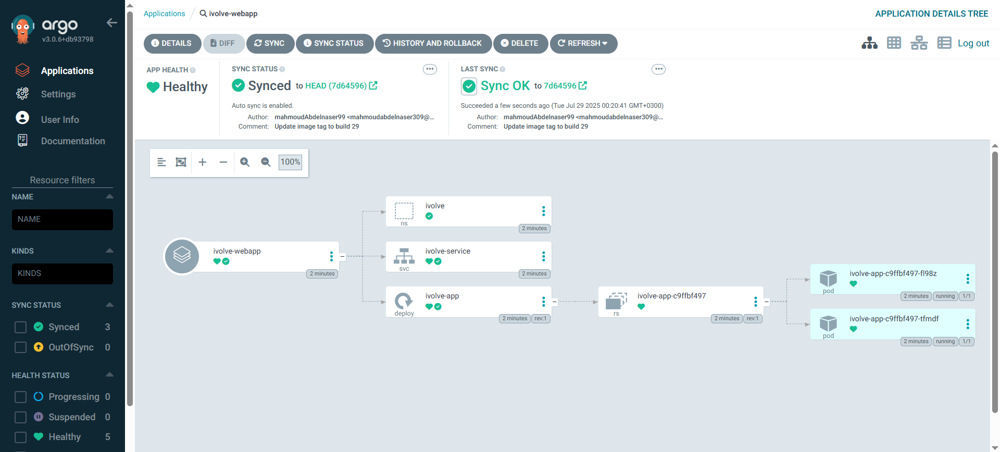

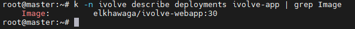
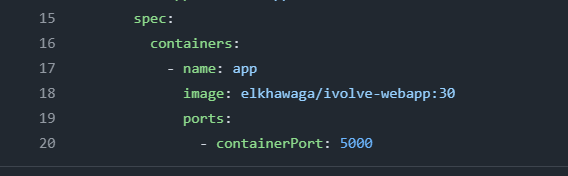
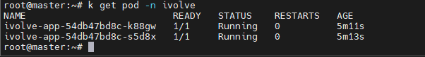
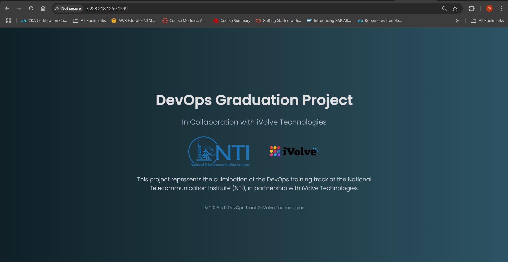
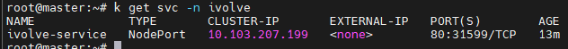

</details>
