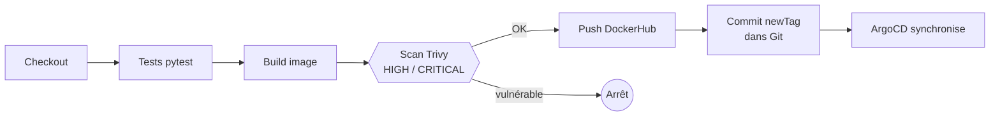
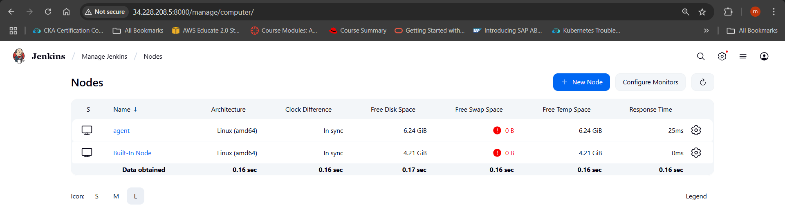
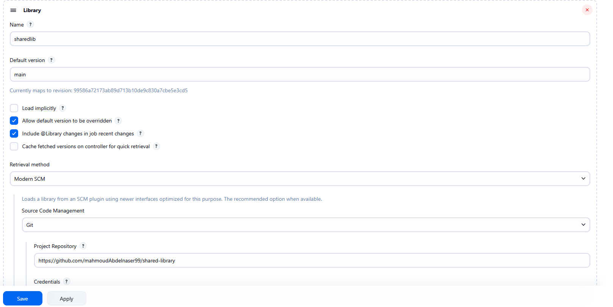
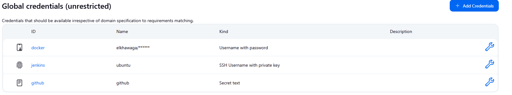
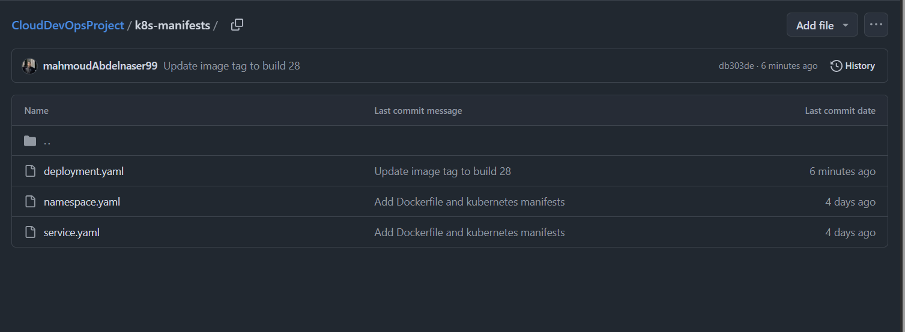
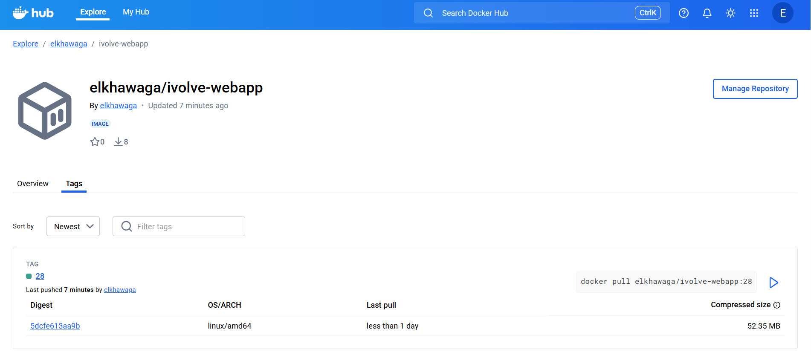
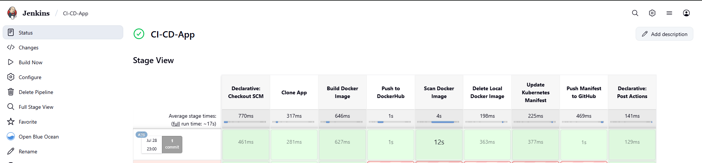

# 🔁 Jenkins — pipeline CI/CD

Le **Jenkinsfile** est autonome (aucune bibliothèque partagée) et s'exécute sur l'agent `slave`.
Tout est créé par Ansible : utilisateur, plugins, credentials, agent et job `ivolve-webapp` (voir `Ansible/roles/jenkins_master`).

## Stages

| Stage | Détail |
|---|---|
| **Checkout** | Calcule `IMAGE_TAG = <build>-<sha git>` ; ignore les commits du bot `jenkins-ci` pour éviter une boucle |
| **Tests unitaires** | `pytest` dans un conteneur `python:3.12-slim` lancé avec l'UID de l'agent (aucun fichier root dans le workspace) |
| **Build image** | `docker build --pull` avec `APP_VERSION` exposée sur `/version` |
| **Scan Trivy** | Rapport complet archivé, puis contrôle **bloquant** (`HIGH,CRITICAL`, `--ignore-unfixed`) — **avant** toute publication |
| **Push DockerHub** | Connexion par `--password-stdin` (le token n'apparaît pas dans les logs) |
| **Mise à jour GitOps** | `sed` sur la seule ligne `newTag` de `k8s-manifests/kustomization.yaml`, `fetch` + `rebase` puis `push` |

## Credentials attendus

| ID | Type | Contenu |
|---|---|---|
| `docker` | Username/password | utilisateur DockerHub + *Access Token* |
| `github` | Username/password | utilisateur GitHub + PAT (écriture) |
| `agent-ssh` | SSH key | clé du master vers l'agent |

Ils sont déclarés automatiquement par JCasC à partir du Vault Ansible.

## À adapter

Dans le bloc `environment` du `Jenkinsfile` : `DOCKER_REPO`, `GITOPS_REPO`, `GITOPS_BRANCH`.

## Pourquoi plus de bibliothèque partagée ?

L'ancienne version dépendait d'une `sharedlib` hébergée dans un autre dépôt, absente de ce projet et donc non reproductible. Les cinq étapes tiennent en quelques lignes : les garder dans le `Jenkinsfile` rend le pipeline lisible, versionné avec le code et testable.

<b>📸 Captures de la mise en œuvre d'origine</b>

 

