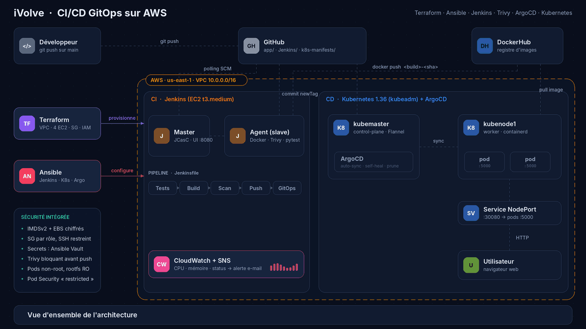
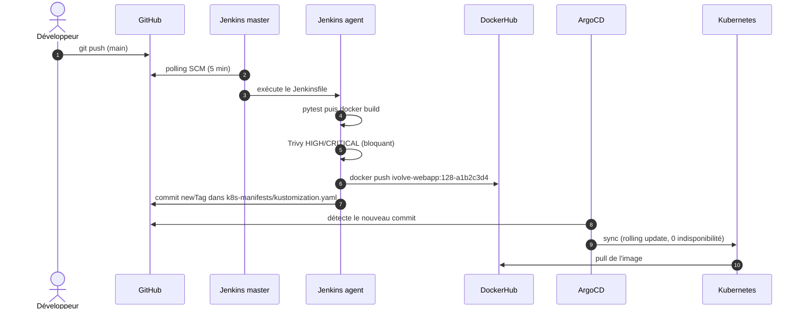

<div align="center">

# ☁️ iVolve — CI/CD GitOps sur AWS

**Une chaîne DevOps complète, reproductible et sécurisée : du `git push` au pod Kubernetes, sans intervention manuelle.**


<br>



<sub>Animation générée par <code>scripts/make_architecture_gif.py</code> · vue statique : <a href="docs/architecture.png">docs/architecture.png</a></sub>

</div>

---

## ✨ En un coup d'œil

| | |
|---|---|
| 🏗️ **Infrastructure as Code** | VPC, 4 EC2, security groups, IAM, CloudWatch et SNS créés par **Terraform** (backend S3 chiffré + verrou DynamoDB) |
| 🔧 **Configuration automatisée** | **Ansible** installe Jenkins (JCasC, plugins, agent enregistré), un cluster **kubeadm**, ArgoCD et l'agent CloudWatch |
| 🔁 **CI Jenkins** | Tests → build → **scan Trivy bloquant** → push DockerHub → commit GitOps, avec tags d'image immuables `<build>-<sha>` |
| 🚀 **CD GitOps** | **ArgoCD** synchronise le cluster depuis Git (auto-sync, self-heal, prune) : Git est la seule source de vérité |
| 🛡️ **Sécurité par défaut** | IMDSv2, volumes chiffrés, SSH restreint à votre IP, secrets dans Ansible Vault, pods non-root en lecture seule |
| 🧪 **Qualité** | Tests `pytest`, CI GitHub Actions : `terraform validate`, `tfsec`, `ansible-lint`, `hadolint`, `kubeconform` |

## 📑 Sommaire

1. [Architecture](#-architecture)
2. [Le flux CI/CD en 8 étapes](#-le-flux-cicd-en-8-étapes)
3. [Structure du dépôt](#-structure-du-dépôt)
4. [Démarrage rapide](#-démarrage-rapide)
5. [Ce qu'il faut adapter](#-ce-quil-faut-adapter)
6. [Sécurité](#-sécurité)
7. [Qualité & automatisation](#-qualité--automatisation)
8. [Dépannage](#-dépannage)
9. [Pistes d'évolution](#-pistes-dévolution)
10. [Crédits](#-crédits)

---

## 🏛️ Architecture

| Couche | Composant | Rôle |
|---|---|---|
| **Provisioning** | Terraform | VPC `10.0.0.0/16`, 2 sous-réseaux publics, 4 EC2 Ubuntu 22.04 (`jenkins-master`, `jenkins-slave`, `kubemaster`, `kubenode1`), SG par rôle, rôle IAM (SSM + CloudWatch) |
| **Configuration** | Ansible | Rôles `common`, `git`, `java`, `docker`, `jenkins_master`, `jenkins_agent`, `kubeadm`, `k8s_addons`, `cloudwatch_agent` ; inventaire AWS dynamique |
| **CI** | Jenkins (master + agent SSH) | Pipeline `Jenkins/Jenkinsfile`, job créé automatiquement par JCasC / Job DSL |
| **Registre** | DockerHub | Images `ivolve-webapp:<build>-<sha>` |
| **CD** | ArgoCD | Application `ivolve-webapp` → `k8s-manifests/` (Kustomize) |
| **Runtime** | Kubernetes 1.36 (kubeadm, containerd 2, Flannel) | 2 pods Flask/Gunicorn, Service NodePort `:30080`, HPA 2→5, PodDisruptionBudget |
| **Supervision** | CloudWatch + SNS | Tableau de bord, alarmes CPU / mémoire / status check, notification e-mail |

## 🔄 Le flux CI/CD en 8 étapes



| # | Étape | Garde-fou |
|---|---|---|
| 1 | Push du code sur GitHub | — |
| 2 | Jenkins détecte le commit et délègue à l'agent | Les commits du bot `jenkins-ci` sont ignorés (pas de boucle infinie) |
| 3 | Tests `pytest` (conteneur jetable) puis build de l'image | Build interrompu si un test échoue |
| 4 | **Scan Trivy avant publication** | Aucune image HIGH/CRITICAL (corrigeable) n'atteint le registre |
| 5 | Push `ivolve-webapp:<build>-<sha>` | Tag immuable, jamais `:latest` |
| 6 | Commit automatique de `newTag` dans Git | Seule la ligne `newTag` est modifiée |
| 7 | ArgoCD détecte et synchronise | `selfHeal` annule toute dérive manuelle, `prune` supprime l'obsolète |
| 8 | Le nœud tire l'image, 2 pods démarrent | `readinessProbe`, `maxUnavailable: 0` |

## 🗂️ Structure du dépôt

```text
.
├── app/                     # Application Flask + Dockerfile multi-étapes + tests pytest
├── Ansible/                 # Rôles, playbooks, inventaire AWS dynamique, Vault
│   ├── playbooks/           #   site.yml · jenkins.yml · kubernetes.yml · monitoring.yml
│   └── roles/               #   common · git · java · docker · jenkins_master · jenkins_agent
│                            #   kubeadm · k8s_addons · cloudwatch_agent
├── ArgoCD/                  # Application ArgoCD déclarative
├── Jenkins/Jenkinsfile      # Pipeline test → build → scan → push → GitOps
├── k8s-manifests/           # Kustomize : namespace, deployment, service, HPA, PDB
├── terraform/               # Modules network + compute, bootstrap du backend
│   └── bootstrap/           #   bucket S3 versionné/chiffré + table DynamoDB de verrou
├── docs/                    # architecture.gif / .png
├── scripts/                 # Générateur du GIF d'architecture
├── .github/workflows/ci.yml # Qualité & sécurité du code d'infrastructure
└── Makefile                 # `make help` pour la liste des commandes
```

## 🚀 Démarrage rapide

### Prérequis

- Compte **AWS** (CLI configurée), une **paire de clés EC2** (ex. `jenkins-key`) dont le `.pem` est dans `~/.ssh/` (`chmod 400`)
- **Terraform ≥ 1.5**, **Python 3** et `pip install -r Ansible/requirements-dev.txt`
- Un compte **DockerHub** (créez un *Access Token*) et un **PAT GitHub** avec droit d'écriture sur le dépôt
- Dépôt GitHub **public** (ou ajoutez un secret de dépôt dans ArgoCD pour un dépôt privé)

### 1 · Créer le backend Terraform (une seule fois)

```bash
cd terraform/bootstrap
terraform init
terraform apply -var 'state_bucket_name=<un-nom-de-bucket-unique>'
terraform output -raw backend_hcl > ../backend.hcl      # nom du bucket et de la table de verrou
```

### 2 · Provisionner l'infrastructure

```bash
cd ../                                                  # dossier terraform/
cp terraform.tfvars.example terraform.tfvars            # renseignez admin_cidrs = ["<votre-IP>/32"]
terraform init -backend-config=backend.hcl
terraform apply
```

### 3 · Configurer les machines

```bash
cd ../Ansible
ansible-galaxy collection install -r requirements.yml -p collections

# Secrets : mot de passe Jenkins, tokens DockerHub / GitHub
cp group_vars/all/vault.yml.example group_vars/all/vault.yml
$EDITOR group_vars/all/vault.yml
echo 'un-mot-de-passe-vault' > .vault_pass && chmod 600 .vault_pass     # fichier ignoré par git
ansible-vault encrypt group_vars/all/vault.yml --vault-password-file .vault_pass

ansible-inventory --graph                               # vérifie que les 4 machines sont vues
ansible-playbook playbooks/site.yml --vault-password-file .vault_pass
```

> ⏱️ Comptez 10 à 15 minutes : installation de Jenkins et des plugins, `kubeadm init`, jonction du worker, ArgoCD.

### 3 bis · Pousser le code

```bash
git push origin main     # adaptez d'abord les identifiants (voir « Ce qu'il faut adapter »)
```

### 4 · Vérifier

| Quoi | Comment |
|---|---|
| **Jenkins** | `http://<IP publique jenkins-master>:8080` (utilisateur `admin`, mot de passe du Vault). Le job `ivolve-webapp` et l'agent `slave` existent déjà |
| **Cluster** | `ssh ubuntu@<IP kubemaster>` puis `kubectl get nodes,pods -A` |
| **ArgoCD** | `kubectl -n argocd port-forward svc/argocd-server 8081:443` → `https://localhost:8081` · mot de passe : `kubectl -n argocd get secret argocd-initial-admin-secret -o jsonpath="{.data.password}" \| base64 -d` |
| **Application** | `http://<IP publique d'un nœud>:30080` · sondes : `/health`, `/version` |
| **Supervision** | URL `cloudwatch_dashboard_url` affichée par `terraform output` |

### 5 · Nettoyer

```bash
terraform -chdir=terraform destroy      # 4 instances t3.medium facturées tant qu'elles tournent
```

## 🧩 Ce qu'il faut adapter

Les valeurs ci-dessous sont des **exemples** : remplacez-les par les vôtres avant de déployer.

| Valeur | Où la changer |
|---|---|
| Utilisateur / dépôt GitHub | `Jenkins/Jenkinsfile` (`GITOPS_REPO`) · `ArgoCD/application.yaml` (`repoURL`) · `Ansible/group_vars/all/main.yml` (`gitops_repo_url`) |
| Compte DockerHub | `Jenkins/Jenkinsfile` (`DOCKER_REPO`) · `k8s-manifests/kustomization.yaml` (`newName`) |
| Votre IP d'administration | `terraform/terraform.tfvars` (`admin_cidrs`) — `0.0.0.0/0` est refusé par une validation |
| Région / zones | `terraform/terraform.tfvars` · `Ansible/inventory/aws_ec2.yaml` |
| Nom du projet | `project_name` (Terraform) et le filtre `tag:Project` de l'inventaire Ansible |
| Version de Kubernetes | `Ansible/group_vars/all/main.yml` (`kubernetes_version`) |

## 🛡️ Sécurité

| Domaine | Mesure |
|---|---|
| **Réseau** | Un security group par rôle ; SSH, Jenkins (8080) et API Kubernetes (6443) limités à `admin_cidrs` ; trafic inter-nœuds restreint au groupe lui-même ; SG par défaut du VPC verrouillé |
| **EC2** | IMDSv2 obligatoire (`hop limit = 1`), volumes gp3 **chiffrés**, rôle IAM minimal avec **SSM** (accès sans SSH possible) |
| **Terraform** | État chiffré, versionné, verrouillé ; `prevent_destroy` sur le bucket ; versions de providers figées ; `.terraform.lock.hcl` commité |
| **Secrets** | **Ansible Vault** ; fichier `0600` pour les variables d'environnement Jenkins ; aucun secret dans Git ; identifiants injectés via JCasC |
| **Supply chain** | Scan **Trivy bloquant avant** le push ; tags immuables ; images épinglées ; dépendances Python figées |
| **Conteneur** | Multi-stage, utilisateur UID 10001, Gunicorn, `HEALTHCHECK`, `.dockerignore` |
| **Kubernetes** | `runAsNonRoot`, `readOnlyRootFilesystem`, `capabilities: drop ALL`, `seccomp RuntimeDefault`, Pod Security Admission `restricted`, pas de token de service monté |
| **Cluster** | Versions kubeadm **gelées** (`apt hold`), plus aucun `--ignore-preflight-errors=all` |

> ⚠️ Les nœuds restent dans des sous-réseaux **publics** (un NAT Gateway coûte cher pour un environnement de formation). Leur exposition est neutralisée par des security groups stricts ; en production, passez en sous-réseaux privés + ALB.

## 🧪 Qualité & automatisation

```bash
make help            # liste des commandes
make test            # pytest
make lint            # yamllint, ansible-lint, terraform fmt, kubeconform
make docker-run      # l'application sur http://localhost:5000
make architecture    # régénère le GIF d'architecture
```

La CI GitHub Actions (`.github/workflows/ci.yml`) exécute à chaque PR : `pytest` + `hadolint`, `terraform fmt/validate` + `tfsec`, `yamllint` + `ansible-lint`, `kustomize build` + `kubeconform`.

## 🩺 Dépannage

| Symptôme | Piste |
|---|---|
| `ansible-inventory` ne liste rien | Vérifiez `aws sts get-caller-identity`, la région, que les instances sont `running` et portent le tag `Project=ivolve` |
| `apt update` : `NO_PUBKEY` ou signature invalide sur le dépôt Jenkins | Le dépôt Jenkins change de clé régulièrement ; ce projet utilise `jenkins.io-2026.key` (voir `roles/jenkins_master/tasks/install.yml`) |
| L'agent `slave` reste hors ligne | `ssh jenkins@<IP privée>` depuis le master ; `known_hosts` de l'utilisateur `jenkins` ; relancez `ansible-playbook playbooks/jenkins.yml` |
| Pipeline bloqué au scan | Trivy a trouvé une CVE HIGH/CRITICAL corrigeable : mettez à jour la dépendance ou l'image de base (le rapport est archivé dans le build) |
| Pods `ImagePullBackOff` | `newName` / `newTag` de `kustomization.yaml` ne pointent pas vers une image publiée ; dépôt DockerHub privé ? |
| ArgoCD `OutOfSync` / `Unknown` | Dépôt privé (ajoutez un identifiant), `repoURL` incorrecte, ou chemin `k8s-manifests` absent de la branche |
| `kubectl top` : *metrics not available* | Attendez 1 à 2 min après l'installation de metrics-server ; le flag `--kubelet-insecure-tls` est posé par Ansible |
| `terraform apply` : *AMI not found* | Fixez `ami_id` dans `terraform.tfvars` (région différente de `us-east-1`) |

## 🔭 Pistes d'évolution

- **Exposition HTTP** : `ingress-nginx` est archivé (mars 2026) ; viser la **Gateway API** (Envoy Gateway, Traefik, Cilium) plutôt qu'un Ingress classique
- **Réseau** : sous-réseaux privés + NAT + ALB ; CNI **Calico/Cilium** pour appliquer des `NetworkPolicy` (Flannel ne les applique pas)
- **Observabilité** : Prometheus + Grafana (kube-prometheus-stack), logs centralisés
- **Supply chain** : signature d'images avec **cosign**, SBOM (Syft), politiques d'admission (Kyverno)
- **Environnements** : overlays Kustomize `dev` / `staging` / `prod`, promotion par PR
- **Secrets** : External Secrets Operator ou HashiCorp Vault, plus de tokens longue durée
- **Maintenance** : Renovate/Dependabot pour les versions épinglées (providers, actions, images)

## 👥 Crédits

Projet de fin de formation **DevOps — NTI × iVolve Technologies**, repris et durci par **Roudayna Kouka** ([@roudayn-kouka](https://github.com/roudayn-kouka)).

<details>
<summary><b>Documentation détaillée par composant</b></summary>

- [Terraform](./terraform/README.md) · [Ansible](./Ansible/README.md) · [Jenkins](./Jenkins/README.md)
- [Application & Docker](./app/README.md) · [Manifestes Kubernetes](./k8s-manifests/README.md) · [ArgoCD](./ArgoCD/README.md)

</details>
