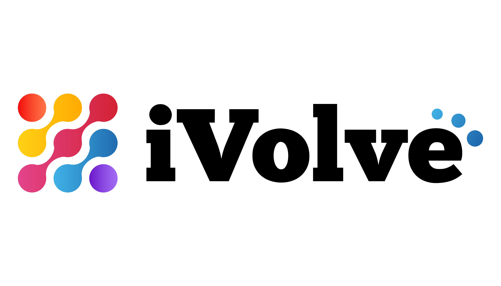

<p align="center">
  
  &nbsp;&nbsp;&nbsp;&nbsp;
  
</p>

<h1 align="center">🐍 Application web iVolve</h1>

<p align="center">Petite application <b>Flask</b> servie par <b>Gunicorn</b>, conteneurisée en multi-étapes et exécutée sans privilèges.</p>

---

## Endpoints

| Route | Réponse |
|---|---|
| `/` | Page d'accueil du projet de fin de formation NTI × iVolve |
| `/health` | `{"status": "ok"}` — utilisée par les sondes Kubernetes et le `HEALTHCHECK` Docker |
| `/version` | `{"version": "<build>-<sha>"}` — injectée via `APP_VERSION` |

## Développement local

```bash
python3 -m venv .venv && source .venv/bin/activate
pip install -r requirements.txt -r requirements-dev.txt
python -m pytest -q                 # 5 tests
python app.py                       # http://127.0.0.1:5000
```

## Docker

```bash
docker build --build-arg APP_VERSION=local -t ivolve-webapp:local .
docker run --rm -p 5000:5000 ivolve-webapp:local
curl localhost:5000/health
```

## Choix de conception

| Choix | Raison |
|---|---|
| Build **multi-étapes** (venv copié dans l'image finale) | Image plus petite, aucun outil de build à l'exécution |
| Utilisateur **UID 10001** | Compatible `runAsNonRoot` / Pod Security `restricted` |
| **Gunicorn** `--worker-tmp-dir /dev/shm` | Serveur de production ; fonctionne avec un rootfs en lecture seule |
| Dépendances **épinglées** | Builds reproductibles, scan Trivy cohérent |
| `.dockerignore` | Ni tests, ni `.git`, ni documentation dans l'image |
| `HEALTHCHECK` | Détection locale d'un conteneur défaillant |
