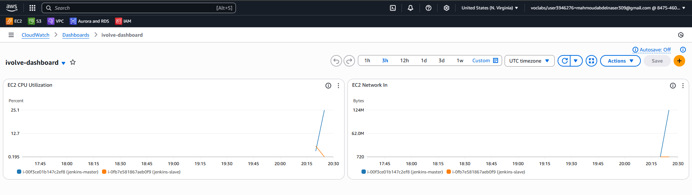
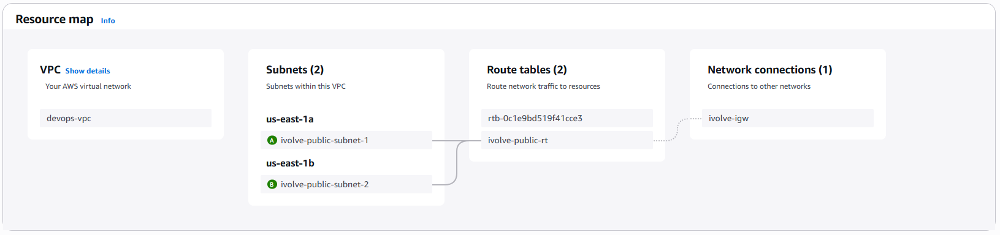
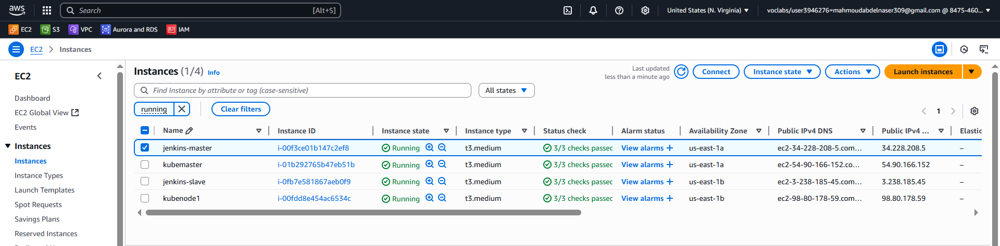
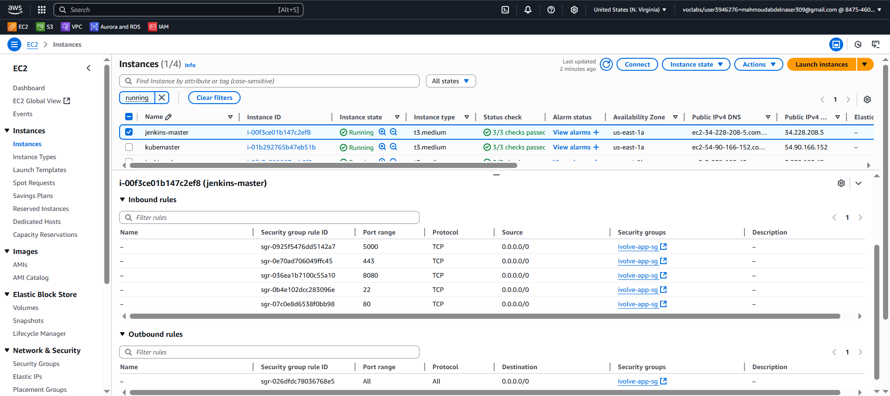
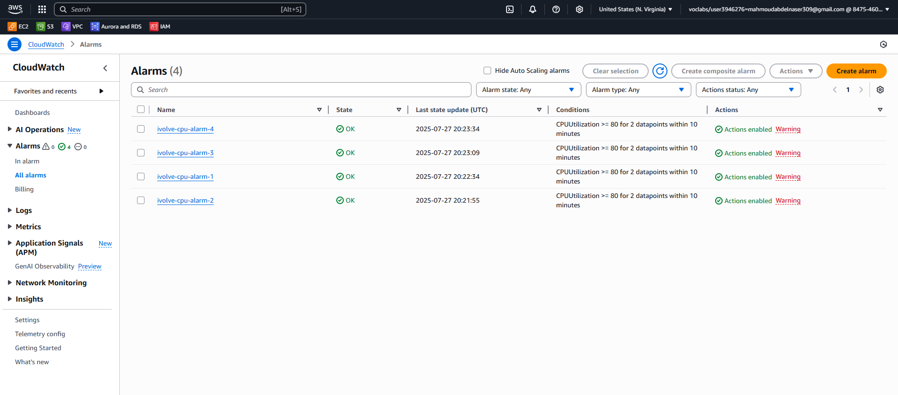
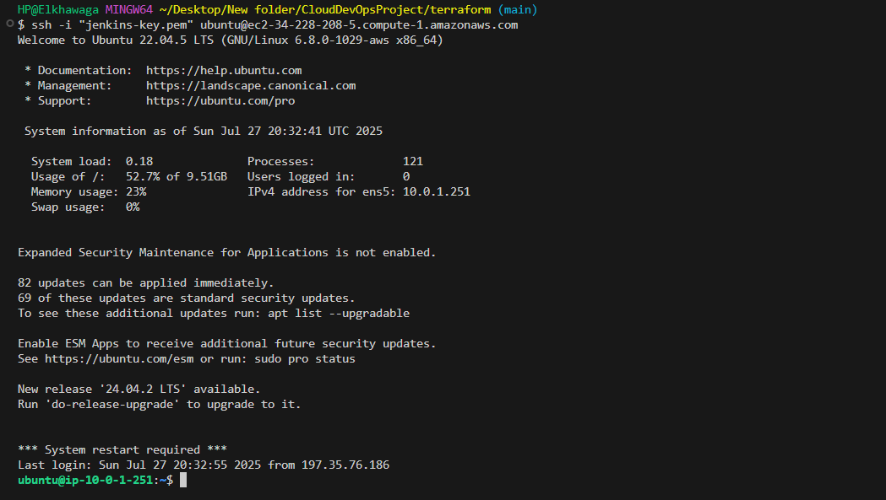
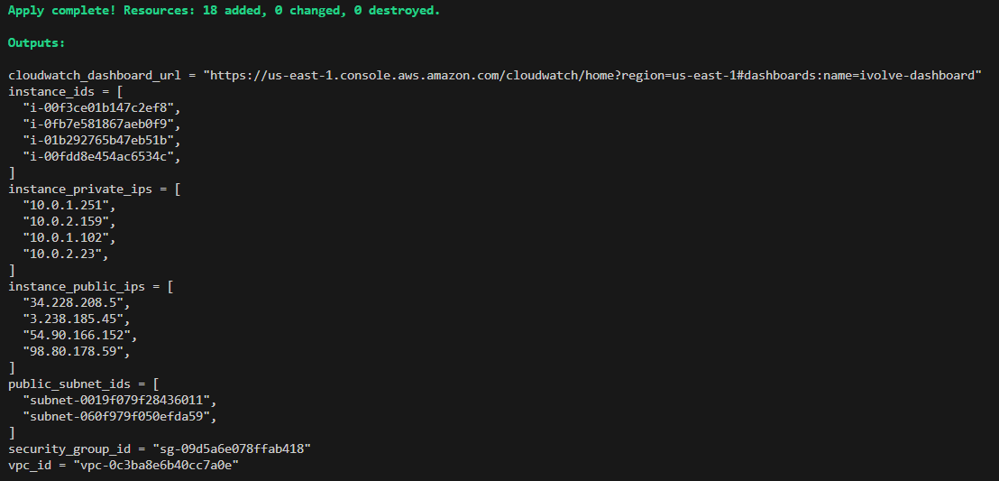

# 🏗️ Terraform — infrastructure AWS

Crée le réseau, 4 instances EC2, les security groups, le rôle IAM, les alarmes CloudWatch et le topic SNS.

```text
terraform/
├── bootstrap/        # S3 (versionné, chiffré) + DynamoDB de verrou — à exécuter une seule fois
├── modules/
│   ├── network/      # VPC, IGW, 2 sous-réseaux publics, table de routage, SG par défaut verrouillé
│   └── compute/      # AMI Ubuntu 22.04, SG jenkins/k8s, IAM (SSM + CloudWatch), EC2 (for_each), alarmes, SNS
├── main.tf           # assemble les modules + tableau de bord CloudWatch
├── backend.tf        # backend S3 (bucket et table passés via backend.hcl)
├── versions.tf       # Terraform ≥ 1.5, provider AWS ~> 5.70
└── terraform.tfvars.example
```

## Utilisation

```bash
# 1. Backend (une fois)
cd bootstrap && terraform init && terraform apply -var 'state_bucket_name=<nom-unique>'
terraform output -raw backend_hcl > ../backend.hcl && cd ..

# 2. Infrastructure
cp terraform.tfvars.example terraform.tfvars      # renseignez admin_cidrs avec VOTRE IP
terraform init -backend-config=backend.hcl
terraform plan
terraform apply
```

## Variables principales

| Variable | Défaut | Description |
|---|---|---|
| `project_name` | — | Préfixe des ressources et tag `Project` (utilisé par l'inventaire Ansible) |
| `admin_cidrs` | — | **Obligatoire.** CIDR autorisés pour SSH / Jenkins / API K8s. `0.0.0.0/0` refusé |
| `app_allowed_cidrs` | `admin_cidrs` | Qui peut joindre l'application (NodePorts 30000-32767) |
| `instances` | 4 × `t3.medium` | Map `nom → { role, instance_type, volume_size }` ; ajouter un worker = une ligne |
| `ami_id` | Ubuntu 22.04 la plus récente | Surcharge optionnelle |
| `alert_email` | `""` | Abonné SNS (confirmer le lien reçu par e-mail) |

## Ce qui a changé par rapport à la version d'origine

| Avant | Après |
|---|---|
| Un SG unique ouvert à `0.0.0.0/0` (22, 80, 443, 8080, 5000) | SG **par rôle**, accès admin limité à votre IP, ports K8s inter-nœuds ouverts uniquement au sein du groupe |
| `count = 4` + noms dans une map d'index | `for_each` sur une map nommée |
| AMI codée en dur et incohérente | AMI Canonical résolue dynamiquement, `ignore_changes = [ami]` |
| Disque 10 Go gp2 non chiffré | gp3 30-40 Go **chiffré**, IMDSv2 obligatoire |
| Backend sans verrou | S3 chiffré + DynamoDB, noms fournis par `backend.hcl` |
| Dashboard limité à 2 instances, SNS sans abonné | Dashboard sur **toutes** les instances (CPU, réseau, mémoire, status), abonnement e-mail, alarmes CPU/mémoire/status |
| Pas de versions figées | `required_version`, provider `~> 5.70`, `default_tags`, lock file à commiter |

## Sorties utiles

`terraform output instance_public_ips` · `terraform output cloudwatch_dashboard_url`

<details>
<summary><b>📸 Captures de la mise en œuvre d'origine</b></summary>
<br>









</details>
